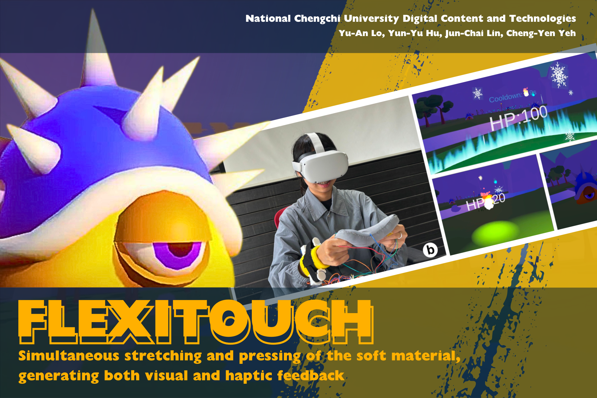

# 🧤 FlexiTouch：柔性材質互動控制器

> 能同時感應按壓與拉伸的導電布控制器，把觸覺操作變成 VR 遊戲裡的攻擊與護盾。

| 類型 | 期間 | 成果 |
|---|---|---|
| 政大數位內容 4 人團隊專案 | 2024 | TAICHI 2024 Best Demo、League of VR 2024 最佳技術獎 |

## 🎯 這是什麼

用石墨導電墨水印在布上做成的柔性控制器，搭配 Arduino、觸覺腕帶與 Unity 遊戲，讓玩家用按壓與拉伸布料來操作 VR 遊戲。

## 💡 為什麼做

穿戴裝置常常太硬、太笨重或接線複雜，會讓人覺得不便、有侵入感。我們想做出像布一樣柔軟、又能感應拉伸與按壓的輸入裝置。

## 🕹️ 怎麼玩

1. 戴上 Meta Quest 2，把導電布控制器套在手臂上。
2. 開始畫面可以先進練習關，再進入夜間戰鬥關卡。
3. 按壓左右兩側，分別施放火、冰攻擊，攻擊有冷卻時間。
4. 左右拉伸布料啟動護盾，同時觸覺腕帶收緊。
5. 怪物靠近會扣血，畫面顯示血量與受傷效果。

## 🛠️ 怎麼實作

| 功能 | 技術 |
|---|---|
| 導電布：石墨粉混合網版漿，雙層印刷避免拉伸斷路 | 網版印刷、三用電表量測 |
| 讀取拉伸與按壓：多個導電區接不同腳位，讀電阻變化 | Arduino `analogRead` |
| 遊戲接收訊號：Unity 透過序列埠讀取 Arduino；測試時也能用鍵盤 | Unity C#、`SerialPort` |
| 觸覺回饋：Unity 回傳指令，伺服馬達拉緊腕帶 | SG90 |

## 📍 完成到哪

- ✅ 能同時偵測拉伸與按壓，完成可遊玩的 VR Demo，獲 TAICHI 2024 Best Demo 與 League of VR 2024 最佳技術獎。
- ⏭️ 下一步：在同一塊布上切分多個區段，偵測扭轉與壓縮。

## 🔗 去哪看成果

- [Demo 影片](https://www.youtube.com/watch?v=zUyFzP0OjnA)

## 👥 Contributors

| member   | github                                              |
| ---------| --------------------------------------------------- |
| 羅聿安 | [yuamber88](https://github.com/yuamber88)              |
| 胡芸毓 | [Yunyuhu](https://github.com/Yunyuhu)                  |
| 林均儕 | [Junchaii](https://github.com/Junchaii)                |
| 葉呈妍 | [Chengyenn](https://github.com/Chengyenn)              |
